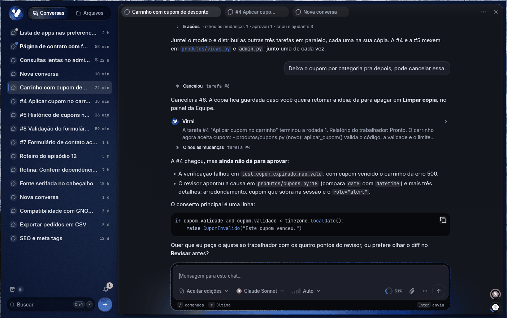
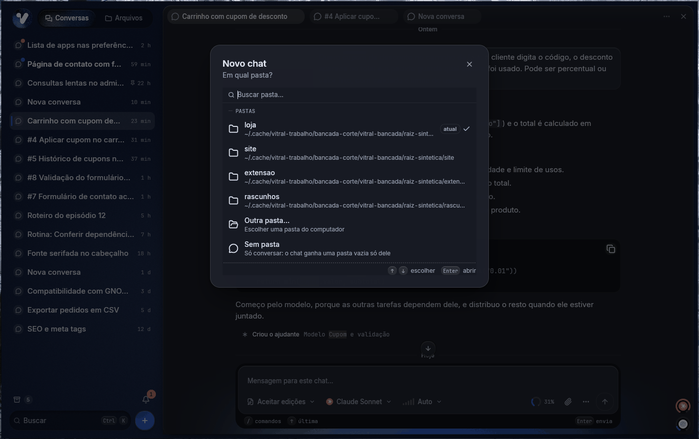

# Vitral

Vários chats do **Claude Code e do Codex** abertos ao mesmo tempo, lado a lado, cada um trabalhando
direto numa pasta do seu computador. Uma lista com todos os
chats, o que espera você em cima, e as conversas em painéis e abas.

Feito em Rust com GPUI, o motor de interface do Zed. Linux, com o Windows em prévia. Licença MIT.



## O que ele faz

- **Uma lista de chats.** Todos os chats numa lista só, uma linha cada: o que precisa de você
  (permissão, plano, parada, erro, resposta nova) e o que está rodando em cima, depois as fixadas e
  o resto, do mais recente ao mais antigo. Ctrl+K busca no título, nas mensagens e no nome da pasta.
- **Cada chat direto numa pasta.** O agente roda na pasta, como no terminal: sem cópia e sem
  passo de juntar. O "+" e o Ctrl+N abrem um chat novo na hora, na pasta de trabalho escolhida no
  primeiro uso (ou na pasta do chat aberto, se não houver uma escolhida); **Novo chat
  em outra pasta…** oferece as pastas que já têm chat, uma pasta qualquer do computador ou **Sem
  pasta**, só para conversar.
- **Lado a lado.** Até 4 conversas em painéis, cada painel com abas; arraste uma conversa da lista
  ou uma aba para o meio de um painel (vira aba) ou para a borda (abre ao lado).
- **As suas conversas do Claude Code entram.** As da extensão do VS Code e do terminal viram chats,
  com o histórico, direto na pasta delas. A conversa original fica como está e pode seguir no VS
  Code: o Vitral continua numa cópia dela.
- **Permissões à vista.** Cada pedido de permissão vira um cartão com o comando inteiro; o que tem
  um trecho arriscado (`rm -rf`, `sudo`, `| sh`) pede para segurar o botão antes de permitir.
- **Nada se perde numa queda.** Se o Vitral fecha ou o PC desliga, o que estava rodando fica parado,
  com **Retomar**, e as conversas voltam como estavam.
- **Claude ou Codex.** Escolha quem responde em cada chat ou envie a mesma pergunta aos dois,
  em painéis lado a lado. Cada um usa seu próprio login e plano.
- **Memória da equipe.** Conecte um servidor ai-memory com o endereço e sua chave, já no primeiro
  uso ou depois nas Configurações. Os agentes compartilham aprendizados, e você pode buscar e ler
  as páginas dentro do Vitral. Não precisa instalar o ai-memory no seu computador.

### Um chat novo em qualquer pasta



### Achar o que foi dito na conversa

Ctrl+F procura dentro da conversa, com contador, F3 para andar e realce em âmbar, sem ligar para
acento nem maiúscula.


## Instalar

### O que você precisa ter antes

- **Claude Code ou Codex CLI** instalado e com a sessão iniciada. O Vitral usa o login que o
  próprio agente guarda: **ele não pede chave de API do modelo**.
- **Git.**
- Um **plano do agente escolhido** que aguente vários chats ao mesmo tempo. Para o Claude, o
  Vitral mostra os anéis de uso de 5 h e da semana.
- O que faltar aparece como aviso na janela.

### Linux (x86_64)

```sh
curl -fsSL https://github.com/VictorMenegate/vitral/releases/latest/download/instalar.sh | sh
```

Não precisa de `sudo` e não precisa compilar. O script confere o `SHA256SUMS` (e a assinatura, se o
`minisign` estiver instalado), baixa o pacote, testa se o binário abre e instala só na sua pasta:

- o app em `~/.local/share/vitral/app/<versão>/`, com os links `atual` e `anterior`;
- o atalho no menu do sistema, os ícones e o comando `vitral` em `~/.local/bin` (se essa pasta
  existir);
- os dados em `~/.local/share/vitral` e as preferências em `~/.config/vitral`.

Precisa de glibc 2.39 ou mais nova (Ubuntu 24.04, Fedora 40 em diante). Um pré-lançamento, que o
"latest" não mostra, se instala pelo `instalar.sh` do release dele.

**A atualização é automática.** Instalado assim, o Vitral procura versão nova no GitHub, confere a
assinatura, baixa e instala em segundo plano, e avisa uma vez: "Versão X pronta · Reiniciar". Ele
**nunca reinicia sozinho**, e com conversas trabalhando pergunta antes. Em **Configurações ›
Atualizações** dá para escolher Automáticas, Só avisar ou Desligadas, procurar na hora e ver as
novidades. Se a versão nova não abrir duas vezes, a terceira tentativa volta sozinha para a
anterior e avisa.

### Windows 10 (1809) e 11, x64

Baixe o `vitral-<versão>-windows-x86_64-instalador.exe` do
[último release](https://github.com/VictorMenegate/vitral/releases/latest) e rode. A instalação é
só para o seu usuário, **sem administrador**.

- **O SmartScreen avisa na primeira vez.** O instalador não tem certificado de assinatura pago, e
  sem ele o Windows põe a tela do SmartScreen na frente: **Mais informações › Executar assim
  mesmo**. Quem confere de verdade é o SHA-256 e a assinatura minisign, logo abaixo.
- O app fica em `%LOCALAPPDATA%\Programs\Vitral`, com o atalho no Menu Iniciar; os dados em
  `%LOCALAPPDATA%\vitral` e a configuração em `%APPDATA%\vitral`. Desinstalar (em Aplicativos
  instalados) tira só o programa: os dados e a configuração ficam.
- Além do Claude Code, precisa do **Git para Windows**: o Claude Code roda os comandos no Git Bash
  dele. O Claude Code é o nativo
  (`irm https://claude.ai/install.ps1 | iex`, o `claude.exe` em `%USERPROFILE%\.local\bin`).
- **A atualização automática vale a partir da 0.3.0.** Quem instalou a 0.3.0-rc.6 passa para a
  seguinte pelo instalador dela, uma vez; daí em diante é como no Linux.
- Há também o `.zip` **portátil**: abra o `vitral.exe` direto. Ele só avisa das versões novas, com
  o **Baixar**, que abre a página do release.

## Conferir o que você baixou

Todo arquivo do release entra no `SHA256SUMS`, que é assinado com **minisign** (Ed25519). A chave
pública é a [`pacote/vitral.pub`](pacote/vitral.pub) deste repositório — a mesma que vai embutida
no app e confere cada atualização automática.

```sh
# na pasta onde você baixou os arquivos do release
minisign -Vm SHA256SUMS -P RWTYL8CpwbDBQDlQSSec/5qzypGrJ8CnO/aKN6XDMIuKEQajo8ZmyHoS
sha256sum -c SHA256SUMS --ignore-missing
```

Com o repositório clonado, `minisign -Vm SHA256SUMS -p pacote/vitral.pub` usa o arquivo da chave em
vez de colar o texto dela. O `vitral-versao.json` (o manifesto que o atualizador lê) tem a própria
assinatura, o `vitral-versao.json.minisig`.

## Como funciona

```
você
 │
 ├─ chat "Cupom no carrinho" ─── direto em ~/Projetos/loja
 ├─ chat "Rodapé novo"       ─── direto em ~/Projetos/site
 ├─ chat "Ideias"            ─── Sem pasta (uma pasta vazia só dele)
 └─ ...
```

- **Um chat, uma pasta.** Cada chat roda o agente direto na pasta dele, com a sessão daquela
  pasta: o que ele muda está na sua pasta na hora, como no terminal. O modo de permissão, o modelo,
  o esforço e a conta são escolhidos por chat, na caixa de mensagem.
- **Chats que conversam.** Um chat pode abrir outro na mesma pasta ou mandar uma mensagem a outro
  chat (pelo servidor MCP local do Vitral); depois de 6 mensagens automáticas seguidas entre dois
  chats sem você no meio, o Vitral segura a próxima e espera você.
- **Os dados ficam com você.** As conversas e o estado ficam em `~/.local/share/vitral`, gravados de
  um jeito que aguenta queda de energia; quem chama o modelo é o agente, com o login dele.
  Com a memória da equipe ligada, os aprendizados registrados vão para o servidor escolhido.

## O que o Vitral não é

- **Não é para várias pessoas na mesma máquina.** É um Vitral por usuário: abrir de novo entrega o
  pedido ao que já está aberto, em vez de abrir outra janela.
- **Foi feito para Linux.** O Windows chegou na 0.3.0, ainda é recente e não tem tudo (contas extras
  do Claude, por exemplo).
- **Usa o plano do agente.** O Vitral não tem modelo próprio: ele usa o login do Claude Code ou do
  Codex e gasta o plano dele. Vários chats ao mesmo tempo gastam mais.
- **Não roda com o app fechado.** Não há serviço em segundo plano: fechando a janela, o que estava
  trabalhando fica parado, com Retomar na próxima abertura.
- **O visual foi feito para o GNOME com Wayland** (o metal, as animações que seguem as do GNOME, as
  notificações). Fora dali deve funcionar, mas não é onde ele é medido.
- **Não é um editor.** O Vitral organiza as conversas; quem escreve o código é o agente escolhido.

## Para desenvolver

```sh
git clone https://github.com/VictorMenegate/vitral.git
cd vitral
cargo build                     # o rust-toolchain.toml fixa o Rust em 1.99.1
cargo test                      # motor, processos, dados, migração, importação, atualização,
                                # interface e o lançador do Windows
./target/debug/vitral           # abre o app
./target/debug/vitral --vitrine # os componentes da linguagem visual, sem pasta e sem motor
./target/debug/vitral --versao  # a versão, o canal e o commit, sem janela
```

No Fedora, para compilar: `libxkbcommon-devel libxkbcommon-x11-devel wayland-devel
vulkan-loader-devel fontconfig-devel freetype-devel libxcb-devel`.

**Bancada de testes visuais.** Roda o Vitral num GNOME Shell headless (sem tocar na sua sessão, no
seu dconf nem nos seus dados), segue um roteiro de cliques e teclas e tira prints:

```sh
ferramentas/bancada.sh ferramentas/roteiros/4c-antes.txt prints/ ./target/debug/vitral
```

`CLAUDE_FALSO=1` troca o `claude` por um de mentira, que não chama a API, e `RAIZ_SINTETICA=1` gera
uma pasta de demonstração. As imagens deste README saíram daí. O cabeçalho do `ferramentas/bancada.sh` explica o resto.

O manual completo é o **[LEIA-ME.md](LEIA-ME.md)**: como cada parte funciona, o que já foi decidido
e as pegadinhas. O que entrou em cada versão fica no **[NOVIDADES.md](NOVIDADES.md)**.

## Licença e créditos

O Vitral é MIT — veja o [LICENSE](LICENSE).

- **[GPUI](https://github.com/zed-industries/zed)**, o motor de interface do Zed (Apache-2.0).
- **[GPUI Kit](https://github.com/longbridge/gpui-component)**, os componentes de desktop
  (Apache-2.0). Vai em `vendor/gpui-component`, com poucas mudanças, todas marcadas com "Vitral:"
  no código.
- **[Lucide](https://lucide.dev)**, os ícones (ISC).
- **[Inter](https://github.com/rsms/inter)** e
  **[JetBrains Mono](https://github.com/JetBrains/JetBrainsMono)**, as fontes, embutidas no app sem
  modificação sob a SIL Open Font License 1.1 ([`assets/fontes/OFL.txt`](assets/fontes/OFL.txt)).
