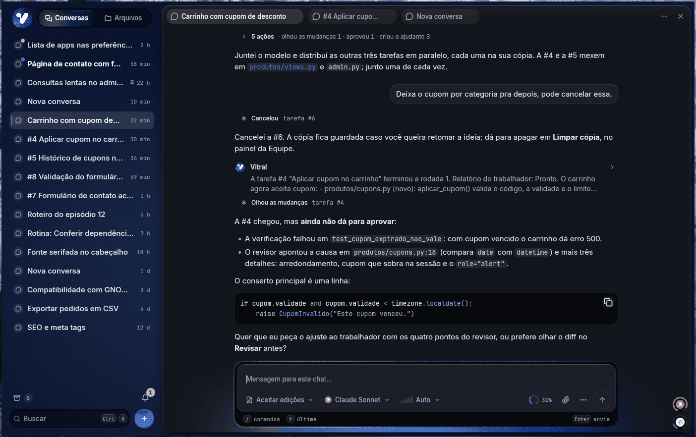
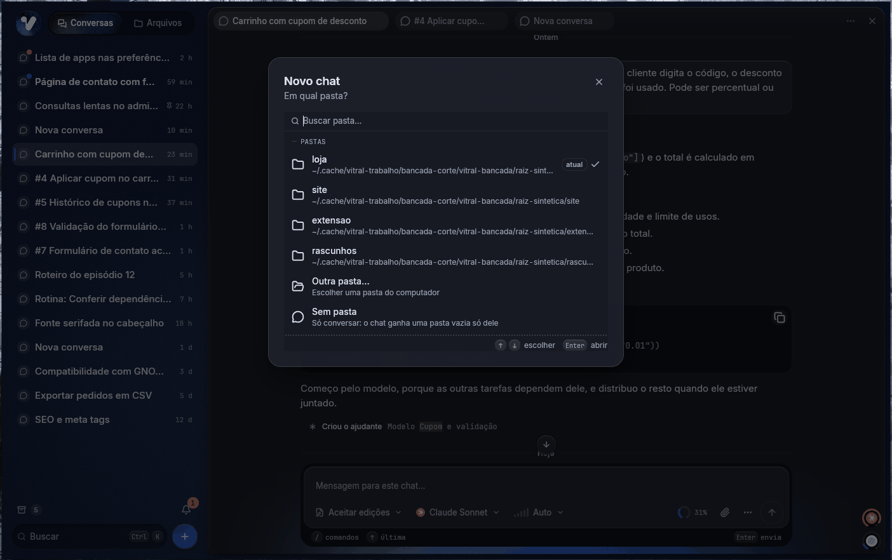
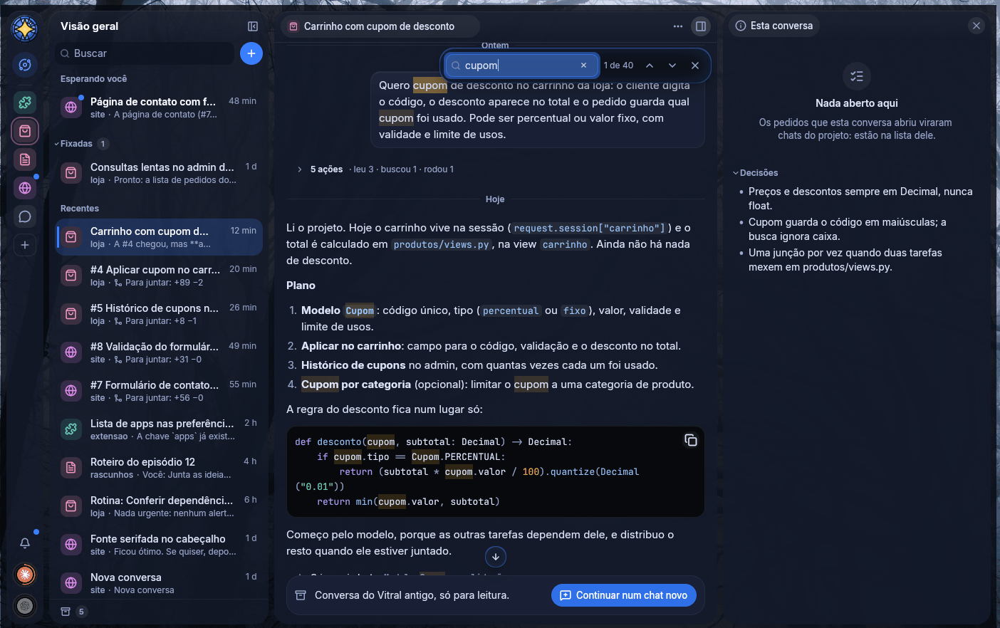

# Vitral

> Português: [README.pt-BR.md](README.pt-BR.md) · Manual in Portuguese: [LEIA-ME.md](LEIA-ME.md)

Several **Claude Code and Codex** chats open at the same time, side by side, each one working
directly in a folder on your computer. One list with every chat, what is waiting for you at the
top, and the conversations in panes and tabs.

Built in Rust with GPUI, the UI framework behind Zed. Linux, with Windows in preview. MIT license.

> The app interface is currently in Portuguese only. Menu and button names are quoted as they appear
> in the app, with the English meaning in parentheses.



## What it does

- **One chat list.** All chats in a single list, one row each: what needs you (permission, plan,
  stop, error, new reply) and what is running on top, then pinned chats and the rest, newest first.
  Ctrl+K searches titles, messages and folder names.
- **Each chat works directly in a folder.** The agent runs in your folder, as in a terminal: no copy
  and no merge step. "+" and Ctrl+N open a new chat right away in the working folder you picked on
  first use (or in the folder of the open chat if none was picked). **Novo chat em outra pasta…**
  (New chat in another folder) offers the folders that already have chats, any folder on your
  computer, or **Sem pasta** (No folder), just to talk.
- **Side by side.** Up to 4 conversations in panes, each pane with tabs. Drag a conversation from the
  list, or a tab, to the middle of a pane (it becomes a tab) or to the edge (it opens beside).
- **Your Claude Code conversations come in.** Sessions from the VS Code extension and the terminal
  become chats, with their history, in their own folder. The original conversation stays as it is
  and can continue in VS Code: Vitral continues on a copy.
- **Claude and Codex in the same chat.** Pick the other agent's model, or start a message with
  `@codex` or `@claude`, and the conversation moves to it with what was already said. With **Os dois
  em toda mensagem** (Both on every message), one answers and the other reviews. Each uses its own
  login and plan.
- **You see what the agent does.** A turn collapses into one line ("Trabalhou 6 min · 13 comandos ·
  editou carrinho.py", meaning worked 6 min, 13 commands, edited carrinho.py) that opens the full
  trail. Subagents show their tools, tokens and time. The agent's task list ("2/5") and the commands
  it left running in the background sit on the turn line; a click there stops the command.
- **Review and undo.** The **Este chat** (This chat) panel shows what the chat edited and, under
  **Na pasta** (In the folder), everything git sees changed since the last commit, with the diff in
  the file itself and an **Desfazer** (Undo) per file. On one of your messages, **voltar os arquivos**
  (restore the files) puts back what Claude changed since then. When two chats edit the same file,
  the conversation warns you.
- **Permissions in plain sight.** Each permission request becomes a card with the full command.
  Anything with a risky part (`rm -rf`, `sudo`, `| sh`) asks you to hold the button before allowing.
- **Plan limits do not stop the work.** At an account's limit, **Continuar na outra** (Continue on
  the other one) switches the chat's account and repeats the turn; **Às 14:20** (At 14:20) repeats
  the turn by itself when the limit resets.
- **Suggested next message.** After each reply, the box suggests what to send next; Tab accepts it.
- **Nothing is lost on a crash.** If Vitral closes or the PC shuts down, what was running stays
  paused with **Retomar** (Resume), and conversations come back as they were. While a chat is
  working, the computer does not suspend.
- **Team memory.** Connect an ai-memory server with its address and your key, on first use or later
  in Configurações (Settings). Agents share what they learn, and you can search and read the pages
  inside Vitral. You do not need to install ai-memory on your computer.

### A new chat in any folder



### Finding what was said

Ctrl+F searches inside the conversation, with a counter, F3 to move between matches and amber
highlights, ignoring accents and case.



## Install

### What you need first

- **Claude Code or Codex CLI** installed and logged in. Vitral uses the login the agent itself
  keeps: **it does not ask for a model API key**.
- **Git.**
- An **agent plan** that can handle several chats at once. For Claude, Vitral shows the 5-hour and
  weekly usage rings.
- Anything missing shows up as a warning in the window.

### Linux (x86_64)

```sh
curl -fsSL https://github.com/VictorMenegate/vitral/releases/latest/download/instalar.sh | sh
```

No `sudo`, no compiling. The script checks `SHA256SUMS` (and the signature, if `minisign` is
installed), downloads the package, tests that the binary starts, and installs only in your home
folder:

- the app in `~/.local/share/vitral/app/<version>/`, with `atual` (current) and `anterior`
  (previous) links;
- the desktop entry, icons and the `vitral` command in `~/.local/bin` (if that folder exists);
- data in `~/.local/share/vitral` and preferences in `~/.config/vitral`.

Needs glibc 2.39 or newer (Ubuntu 24.04, Fedora 40 and later). A prerelease, which "latest" does not
show, is installed with the `instalar.sh` from its own release.

**Updates are automatic.** When installed this way, Vitral looks for a new version on GitHub, checks
the signature, downloads and installs it in the background, and notifies you once: "Versão X pronta
· Reiniciar" (Version X ready, Restart). It **never restarts by itself**, and asks first if
conversations are working. In **Configurações › Atualizações** (Settings, Updates) you can choose
Automáticas, Só avisar or Desligadas (Automatic, Notify only, Off), check right now and read the
release notes. If the new version fails to open twice, the third attempt rolls back to the previous
one and tells you.

### Windows 10 (1809) and 11, x64

Download `vitral-<version>-windows-x86_64-instalador.exe` from the
[latest release](https://github.com/VictorMenegate/vitral/releases/latest) and run it. The install is
per user, **no administrator needed**.

- **SmartScreen warns the first time.** The installer has no paid code-signing certificate, so
  Windows shows the SmartScreen screen: **Mais informações › Executar assim mesmo** (More info, Run
  anyway). The real check is the SHA-256 and the minisign signature, below.
- The app goes to `%LOCALAPPDATA%\Programs\Vitral` with a Start menu shortcut; data in
  `%LOCALAPPDATA%\vitral` and configuration in `%APPDATA%\vitral`. Uninstalling (in Installed apps)
  removes only the program: data and configuration stay.
- Besides Claude Code, you need **Git for Windows**: Claude Code runs its commands in its Git Bash.
  Claude Code should be the native one (`irm https://claude.ai/install.ps1 | iex`, with
  `claude.exe` in `%USERPROFILE%\.local\bin`).
- **Automatic updates work from 0.3.0.** If you installed 0.3.0-rc.6, move to the next one with its
  installer, once; from then on it works as on Linux.
- There is also a **portable** `.zip`: run `vitral.exe` directly. It only notifies about new
  versions, with **Baixar** (Download), which opens the release page.

## Verify what you downloaded

Every release file is listed in `SHA256SUMS`, which is signed with **minisign** (Ed25519). The public
key is [`pacote/vitral.pub`](pacote/vitral.pub) in this repository, the same one embedded in the app
that checks every automatic update.

```sh
# in the folder where you downloaded the release files
minisign -Vm SHA256SUMS -P RWTYL8CpwbDBQDlQSSec/5qzypGrJ8CnO/aKN6XDMIuKEQajo8ZmyHoS
sha256sum -c SHA256SUMS --ignore-missing
```

With the repository cloned, `minisign -Vm SHA256SUMS -p pacote/vitral.pub` uses the key file instead
of pasting its text. `vitral-versao.json` (the manifest the updater reads) has its own signature,
`vitral-versao.json.minisig`.

## How it works

```
you
 │
 ├─ chat "Cupom no carrinho" ─── directly in ~/Projetos/loja
 ├─ chat "Rodapé novo"       ─── directly in ~/Projetos/site
 ├─ chat "Ideias"            ─── Sem pasta (an empty folder just for it)
 └─ ...
```

- **One chat, one folder.** Each chat runs the agent directly in its folder, with that folder's
  session: what it changes is in your folder right away, as in a terminal. Permission mode, model,
  effort and account are chosen per chat, in the message box.
- **Chats that talk to each other.** A chat can open another in the same folder or message another
  chat (through Vitral's local MCP server). After 6 automatic messages in a row between two chats
  with you not in between, Vitral holds the next one and waits for you.
- **Your data stays with you.** Conversations and state live in `~/.local/share/vitral`, written in
  a way that survives power loss. The agent is the one calling the model, with its own login. With
  team memory on, the recorded lessons go to the server you chose.

## What Vitral is not

- **Not for several people on one machine.** It is one Vitral per user: opening it again hands the
  request to the one already open instead of opening another window.
- **Built for Linux.** Windows arrived in 0.3.0, is still new and lacks some things (extra Claude
  accounts, for example).
- **It uses the agent's plan.** Vitral has no model of its own: it uses the Claude Code or Codex
  login and spends that plan. Several chats at once spend more.
- **It does not run with the app closed.** There is no background service: closing the window leaves
  whatever was working paused, with Retomar on the next launch.
- **The look was made for GNOME on Wayland** (the metal, animations that follow GNOME's, the
  notifications). Elsewhere it should work, but that is not where it is measured.
- **Not an editor.** Vitral organizes conversations; the chosen agent writes the code.

## Building from source

```sh
git clone https://github.com/VictorMenegate/vitral.git
cd vitral
cargo build                     # rust-toolchain.toml pins Rust to 1.99.1
cargo test                      # engine, processes, data, migration, import, updates,
                                # UI and the Windows launcher
./target/debug/vitral           # opens the app
./target/debug/vitral --vitrine # the visual language components, no folder and no engine
./target/debug/vitral --versao  # version, channel and commit, no window
```

On Fedora, build dependencies: `libxkbcommon-devel libxkbcommon-x11-devel wayland-devel
vulkan-loader-devel fontconfig-devel freetype-devel libxcb-devel`. On Ubuntu 24.04 (as in CI):
`pkg-config libxkbcommon-dev libxkbcommon-x11-dev libxcb1-dev libx11-xcb-dev libx11-dev
libwayland-dev libvulkan-dev libfontconfig-dev libfreetype-dev`.

**Visual test bench.** It runs Vitral in a headless GNOME Shell (without touching your session, your
dconf or your data), follows a script of clicks and keys, and takes screenshots:

```sh
ferramentas/bancada.sh ferramentas/roteiros/4c-antes.txt prints/ ./target/debug/vitral
```

`CLAUDE_FALSO=1` swaps `claude` for a fake one that does not call the API, and `RAIZ_SINTETICA=1`
generates a demo folder. The images in this README came from there. The header of
`ferramentas/bancada.sh` explains the rest.

## More documentation

- **[Manual](docs/MANUAL.en.md)** (English translation of [LEIA-ME.md](LEIA-ME.md)): how each part
  works, what has been decided, and the gotchas.
- **[CHANGELOG.md](CHANGELOG.md)**: the latest versions in English. The full history is in
  [NOVIDADES.md](NOVIDADES.md) (Portuguese).

## License and credits

Vitral is MIT: see [LICENSE](LICENSE).

- **[GPUI](https://github.com/zed-industries/zed)**, Zed's UI framework (Apache-2.0).
- **[GPUI Kit](https://github.com/longbridge/gpui-component)**, the desktop components
  (Apache-2.0). Lives in `vendor/gpui-component` with few changes, all marked "Vitral:" in the code.
- **[Lucide](https://lucide.dev)**, the icons (ISC).
- **[Inter](https://github.com/rsms/inter)** and
  **[JetBrains Mono](https://github.com/JetBrains/JetBrainsMono)**, the fonts, embedded in the app
  unmodified under the SIL Open Font License 1.1 ([`assets/fontes/OFL.txt`](assets/fontes/OFL.txt)).
