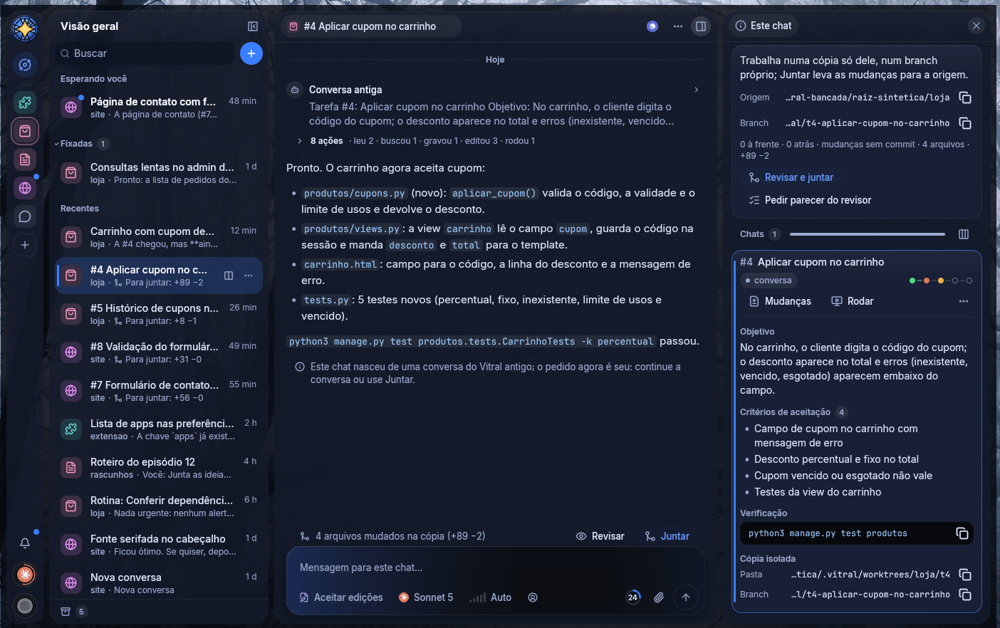
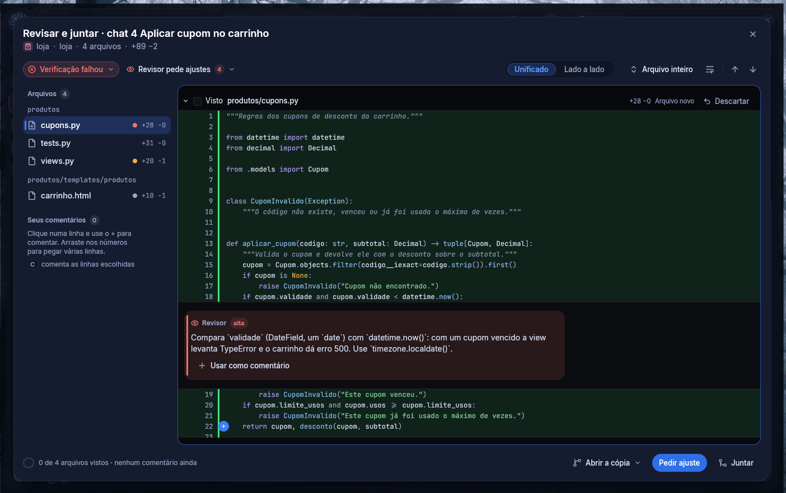
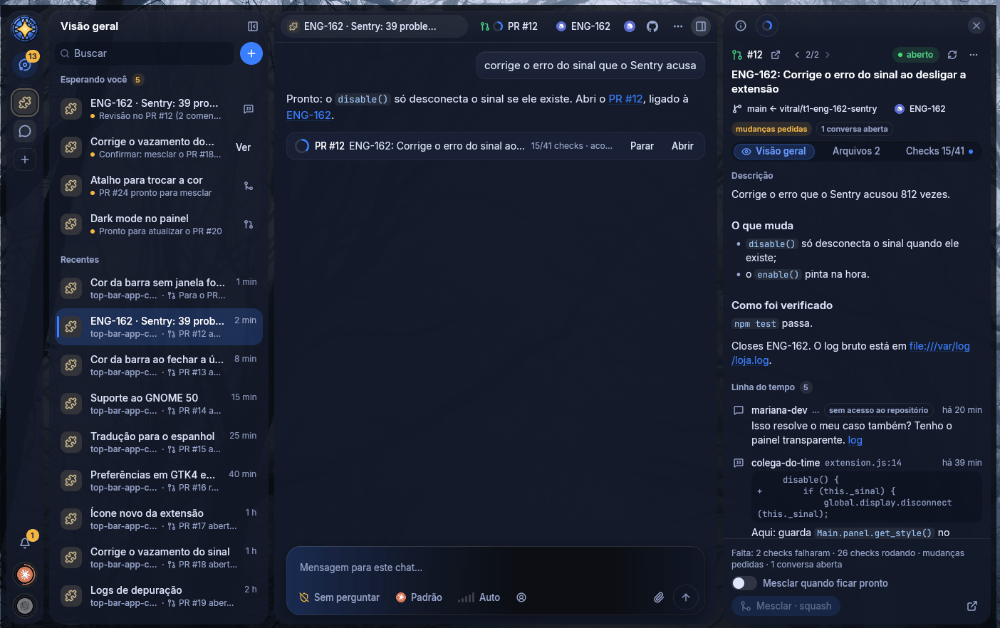
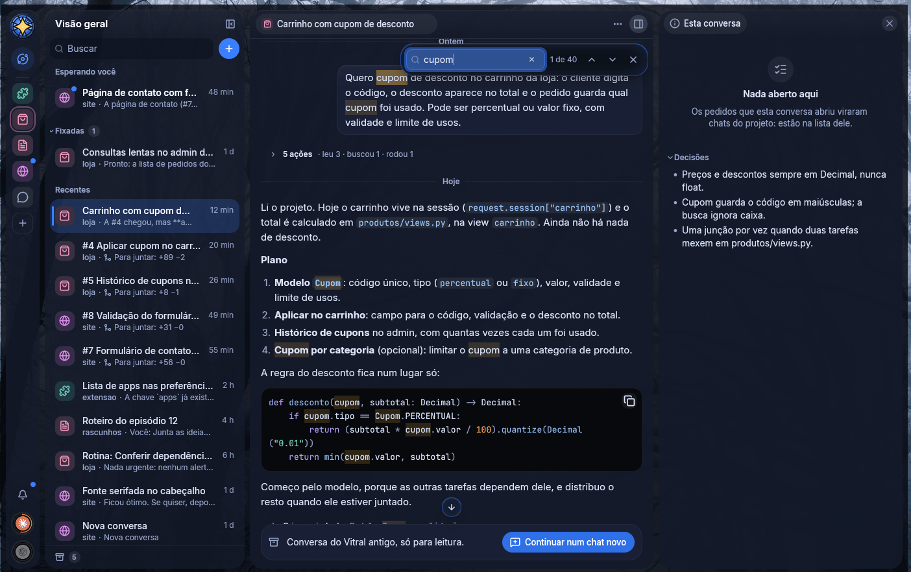

# Vitral

Vários chats do **Claude Code** trabalhando no mesmo pedido, ao mesmo tempo, sem tropeçar um no
outro. Um **Mestre** entende o que você pediu, mostra como vai dividir e manda cada parte para o
projeto certo. Cada chat trabalha numa **cópia só dele** da pasta e nada entra no seu código antes
de passar pela verificação, pelo revisor independente e pelo **Revisar e juntar**.

Feito em Rust com GPUI, o motor de interface do Zed. Linux, com o Windows em prévia. Licença MIT.



## O que ele faz

- **Um Mestre que distribui.** Uma conversa só, que vê todos os projetos. Ele não edita nada: ouve o
  pedido e mostra o cartão **"Vou dividir assim"** (uma parte por chat, com os critérios e o
  comando de verificação), que espera o seu **Começar** — ou vai direto, quando você pediu assim ou
  citou o destino.
- **Um chat por pedido, cada um na sua cópia.** Cada chat de projeto trabalha num `git worktree` só
  dele, com portas próprias. A sua pasta fica como está até você (ou o Mestre) juntar.
- **Verificação, revisor e portão.** Quando o chat para, os testes rodam; depois o Vitral roda a
  verificação de novo e um revisor independente (sessão nova, só de leitura) aponta os problemas com
  arquivo e linha. Com a verificação vermelha ou um problema grave, juntar sozinho é recusado.
- **Revisar e juntar.** O diff com cor de sintaxe, os apontamentos do revisor na própria linha, os
  seus comentários, **Pedir ajuste** e **Juntar**.
- **GitHub e Linear ao lado do chat.** Issues viram chats; o PR abre, acompanha os checks e mescla
  quando tudo passa, numa aba ao lado da conversa.
- **As suas conversas do Claude Code entram.** As da extensão do VS Code e do terminal viram chats,
  com o histórico, no projeto da pasta delas. A conversa original fica como está e pode seguir no
  VS Code: o Vitral continua numa cópia dela.
- **Nada se perde numa queda.** Se o Vitral fecha ou o PC desliga, o que estava rodando fica parado,
  com **Retomar**, e as conversas voltam como estavam.

### O Mestre divide antes de começar

Todo trabalho vira uma divisão, com o pedido inteiro, os critérios e a verificação de cada parte.
O **×** tira uma parte, **Ajustar** devolve a palavra a você e **Começar** cria os chats.


### Nada entra sem passar pelo Revisar



### O pull request ao lado da conversa



### Achar o que foi dito na conversa

Ctrl+F procura dentro da conversa, com contador, F3 para andar e realce em âmbar, sem ligar para
acento nem maiúscula.



## Instalar

### O que você precisa ter antes

- **Claude Code** instalado e com a sessão iniciada. O Vitral usa o login que o próprio Claude Code
  guarda: **ele não pede chave de API** e nunca renova esse login por conta própria.
- **Git.**
- Uma **assinatura do Claude** que aguente vários chats ao mesmo tempo. O Vitral mostra os anéis de
  uso de 5 h e da semana, mas quem cobra é a Anthropic.
- O que faltar aparece como aviso na conversa do Mestre.

### Linux (x86_64)

```sh
curl -fsSL https://github.com/VictorMenegate/vitral/releases/latest/download/instalar.sh | sh
```

Não precisa de `sudo` e não precisa compilar. O script confere o `SHA256SUMS` (e a assinatura, se o
`minisign` estiver instalado), baixa o pacote, testa se o binário abre e instala só na sua pasta:

- o app em `~/.local/share/vitral/app/<versão>/`, com os links `atual` e `anterior`;
- o atalho no menu do sistema, os ícones e o comando `vitral` em `~/.local/bin` (se essa pasta
  existir);
- os dados em `~/.local/share/vitral` e as preferências em `~/.config/vitral`.

Precisa de glibc 2.39 ou mais nova (Ubuntu 24.04, Fedora 40 em diante). Um pré-lançamento, que o
"latest" não mostra, se instala pelo `instalar.sh` do release dele.

**A atualização é automática.** Instalado assim, o Vitral procura versão nova no GitHub, confere a
assinatura, baixa e instala em segundo plano, e avisa uma vez: "Versão X pronta · Reiniciar". Ele
**nunca reinicia sozinho**, e com conversas trabalhando pergunta antes. Em **Configurações ›
Atualizações** dá para escolher Automáticas, Só avisar ou Desligadas, procurar na hora e ver as
novidades. Se a versão nova não abrir duas vezes, a terceira tentativa volta sozinha para a
anterior e avisa.

### Windows 10 (1809) e 11, x64

Baixe o `vitral-<versão>-windows-x86_64-instalador.exe` do
[último release](https://github.com/VictorMenegate/vitral/releases/latest) e rode. A instalação é
só para o seu usuário, **sem administrador**.

- **O SmartScreen avisa na primeira vez.** O instalador não tem certificado de assinatura pago, e
  sem ele o Windows põe a tela do SmartScreen na frente: **Mais informações › Executar assim
  mesmo**. Quem confere de verdade é o SHA-256 e a assinatura minisign, logo abaixo.
- O app fica em `%LOCALAPPDATA%\Programs\Vitral`, com o atalho no Menu Iniciar; os dados em
  `%LOCALAPPDATA%\vitral` e a configuração em `%APPDATA%\vitral`. Desinstalar (em Aplicativos
  instalados) tira só o programa: os dados e a configuração ficam.
- Além do Claude Code, precisa do **Git para Windows**: as cópias, a verificação e o hook rodam no
  Git Bash dele. O Claude Code é o nativo
  (`irm https://claude.ai/install.ps1 | iex`, o `claude.exe` em `%USERPROFILE%\.local\bin`).
- **A atualização automática vale a partir da 0.3.0.** Quem instalou a 0.3.0-rc.6 passa para a
  seguinte pelo instalador dela, uma vez; daí em diante é como no Linux.
- Há também o `.zip` **portátil**: abra o `vitral.exe` direto. Ele só avisa das versões novas, com
  o **Baixar**, que abre a página do release.

## Conferir o que você baixou

Todo arquivo do release entra no `SHA256SUMS`, que é assinado com **minisign** (Ed25519). A chave
pública é a [`pacote/vitral.pub`](pacote/vitral.pub) deste repositório — a mesma que vai embutida
no app e confere cada atualização automática.

```sh
# na pasta onde você baixou os arquivos do release
minisign -Vm SHA256SUMS -P RWTYL8CpwbDBQDlQSSec/5qzypGrJ8CnO/aKN6XDMIuKEQajo8ZmyHoS
sha256sum -c SHA256SUMS --ignore-missing
```

Com o repositório clonado, `minisign -Vm SHA256SUMS -p pacote/vitral.pub` usa o arquivo da chave em
vez de colar o texto dela. O `vitral-versao.json` (o manifesto que o atualizador lê) tem a própria
assinatura, o `vitral-versao.json.minisig`.

## Como funciona

```
você
 │
 └─ Mestre ─── uma conversa só, vê todos os projetos, não edita nada
     │         "Vou dividir assim": uma parte por chat, com critérios
     │
     ├─ chat do projeto A ─── a cópia dele (git worktree, portas próprias)
     │      │
     │      └─ ajudante #1, ajudante #2 ─── cada um numa cópia da cópia
     │
     └─ chat do projeto B ─── a cópia dele (git worktree, portas próprias)

em toda entrega:
    verificação ─► revisor ─► portão ─► Revisar e juntar ─► a sua pasta
```

- **Mestre → chats de projeto → ajudantes.** O Mestre lê, decide e distribui, mas não escreve
  arquivo nenhum. Um chat de projeto que recebeu um pedido grande pode dividi-lo em até 3
  **ajudantes**, cada um numa cópia da cópia dele, e junta o trabalho deles antes de entregar.
- **Uma cópia por chat.** Na primeira mensagem, o Vitral prepara um `git worktree` só daquele chat,
  leva os arquivos locais fora do git (`.env*`, `CLAUDE.local.md`), roda o script de preparação da
  pasta e dá dez portas próprias ao chat. A pasta original fica bloqueada para escrita dele.
- **Verificação, revisor e portão.** Um hook roda os testes quando o chat para (e, se falharem, ele
  continua sozinho); depois o Vitral roda a verificação de novo e um revisor independente confere os
  critérios. Quem pediu só junta uma entrega cujo relatório já saiu; com a verificação falhando ou
  um problema de gravidade alta, o Vitral recusa, e juntar mesmo assim exige um motivo, que fica no
  commit. Você, pelo **Revisar**, junta sem o portão: com algo vermelho ele pergunta antes, e o que
  estava vermelho vai como ressalva no commit.
- **Juntar.** As mudanças da cópia entram na pasta original e a cópia continua, em dia com ela.
  Pasta suja, outro branch ou conflito: nada entra, e o aviso diz o que fazer.
- **GitHub e Linear ao lado do chat.** Issues (minhas, do time, do ciclo) viram chats, com o ramo da
  issue; por pasta dá para escolher entre juntar ali mesmo ou **abrir PR**. O PR aparece numa aba
  com a visão geral, os arquivos e os checks; o CI que falhou e a revisão chegam em "Esperando
  você", e com **Mesclar quando ficar pronto** vão sozinhos ao chat, que corrige até os checks
  passarem.
- **Chats isolados.** Os chats que leem issues, comentários e logs de CI (coisa escrita por
  terceiros), e os de uma pasta que entrega por PR, rodam no `bwrap`: sem o chaveiro, sem o ssh, sem
  o login do `gh` nem as credenciais do git, e com o `.git` do repositório só para leitura. Quem
  fala com o GitHub é o Vitral, não o chat.

## O que o Vitral não é

- **Não é para várias pessoas na mesma máquina.** É um Vitral por usuário: abrir de novo entrega o
  pedido ao que já está aberto, em vez de abrir outra janela.
- **Foi feito para Linux.** O Windows chegou na 0.3.0, ainda é recente e não tem tudo (contas extras
  do Claude, por exemplo).
- **Precisa de uma assinatura do Claude.** O Vitral não tem modelo próprio nem chave de API: ele usa
  o login do Claude Code e gasta o plano dele. Vários chats ao mesmo tempo gastam mais.
- **Não roda com o app fechado.** Não há serviço em segundo plano: fechando a janela, o que estava
  trabalhando fica parado, com Retomar na próxima abertura.
- **O visual foi feito para o GNOME com Wayland** (o vidro, as animações que seguem as do GNOME, as
  notificações, a Lixeira). Fora dali deve funcionar, mas não é onde ele é medido.
- **Não é um editor.** O Vitral conversa, prepara as cópias, confere e junta; quem escreve o código
  é o Claude Code.

## Para desenvolver

```sh
git clone https://github.com/VictorMenegate/vitral.git
cd vitral
cargo build                     # o rust-toolchain.toml fixa o Rust em 1.99.1
cargo test                      # git, motor, revisor, processos, dados, migração, importação,
                                # atualização, interface e o lançador do Windows
./target/debug/vitral           # abre o app
./target/debug/vitral --vitrine # os componentes da linguagem visual, sem pasta e sem motor
./target/debug/vitral --versao  # a versão, o canal e o commit, sem janela
```

No Fedora, para compilar: `libxkbcommon-devel libxkbcommon-x11-devel wayland-devel
vulkan-loader-devel fontconfig-devel freetype-devel libxcb-devel`.

**Bancada de testes visuais.** Roda o Vitral num GNOME Shell headless (sem tocar na sua sessão, no
seu dconf nem nos seus dados), segue um roteiro de cliques e teclas e tira prints:

```sh
ferramentas/bancada.sh ferramentas/roteiros/4c-antes.txt prints/ ./target/debug/vitral
```

`CLAUDE_FALSO=1` troca o `claude` por um de mentira, que não chama a API; `RAIZ_SINTETICA=1` gera
uma pasta de demonstração e `AMOSTRA=prs` monta um PR em cada estado, sem rede. As imagens deste
README saíram daí. O cabeçalho do `ferramentas/bancada.sh` explica o resto.

O manual completo é o **[LEIA-ME.md](LEIA-ME.md)**: como cada parte funciona, o que já foi decidido
e as pegadinhas. O que entrou em cada versão fica no **[NOVIDADES.md](NOVIDADES.md)**.

## Licença e créditos

O Vitral é MIT — veja o [LICENSE](LICENSE).

- **[GPUI](https://github.com/zed-industries/zed)**, o motor de interface do Zed (Apache-2.0).
- **[GPUI Kit](https://github.com/longbridge/gpui-component)**, os componentes de desktop
  (Apache-2.0). Vai em `vendor/gpui-component`, com poucas mudanças, todas marcadas com "Vitral:"
  no código.
- **[Lucide](https://lucide.dev)**, os ícones dos projetos (ISC).
- **[Inter](https://github.com/rsms/inter)** e
  **[JetBrains Mono](https://github.com/JetBrains/JetBrainsMono)**, as fontes, embutidas no app sem
  modificação sob a SIL Open Font License 1.1 ([`assets/fontes/OFL.txt`](assets/fontes/OFL.txt)).
